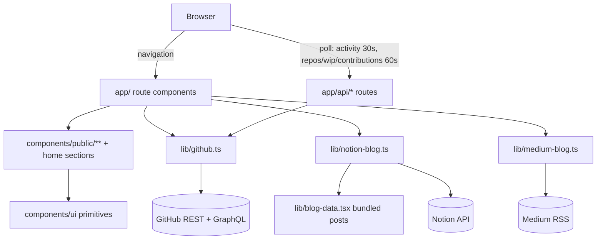

# Architecture

> WinTuner — Personal Site & CV (portfolio for **Thanatphong Tarin**).

## Overview

A server-first Next.js 16 (App Router) application with an editorial,
light-first design: a serif-typography hero, GitHub-powered projects and
activity, a bilingual CV, and a Notion-backed blog — all with graceful
fallbacks when external services are unavailable.

## Technology Stack

| Layer | Choice |
| --- | --- |
| Framework | Next.js 16 (App Router, React 19, TypeScript 5.9) |
| Styling | Tailwind CSS v4 (CSS-first, no `tailwind.config.js`) |
| UI primitives | Radix UI (`@radix-ui/react-avatar`, `react-slot`) |
| Icons | lucide-react + inline SVGs (`components/social-icons.tsx`) |
| Theme | next-themes pinned to dark (`forcedTheme`) + CSS custom properties |
| Language | Custom `LanguageProvider` (EN/TH/JA/ZH), persisted via cookie + localStorage |
| Data fetching | Server Components + ISR + 10-min in-memory cache + hardcoded fallbacks |
| Testing | Vitest + React Testing Library + jsdom |
| Lint/Format | ESLint (flat config, `eslint.config.mjs`) + Prettier-style tabs |
| Package manager | npm (Node 22+, matches CI) |

## Project Structure

```
app/
├── layout.tsx                  # Root layout: fonts, metadata, providers, global widgets
├── page.tsx                    # Homepage (/)
├── globals.css                 # Tailwind v4 + design tokens + animation + print styles
├── not-found.tsx, error.tsx    # Global error boundaries
├── sitemap.ts, robots.ts       # SEO output routes
├── feed.xml/route.ts           # RSS feed for the blog
├── api/
│   ├── contact/route.ts        # Contact form webhook (501 when unconfigured)
│   ├── subscribe/route.ts      # Newsletter webhook (501 when unconfigured)
│   ├── search/route.ts         # Blog search endpoint
│   └── activity/route.ts       # Live GitHub activity (polled every 30s)
└── (public)/                   # Route group: shared Header/Footer
    ├── layout.tsx
    ├── introduction/page.tsx   # CV / resume (?print=true triggers PDF print flow)
    ├── projects/page.tsx       # GitHub-backed project showcase (Suspense + skeleton)
    ├── workbench/page.tsx      # Curated tool stack
    └── blog/
        ├── page.tsx            # Blog list (Notion + Medium merge)
        └── [postSlug]/page.tsx # Individual post
```

```
components/
├── ui/                         # Base primitives (button, input, avatar)
├── hero/                       # Hero portrait + typewriter
├── public/<route>/             # Page-specific feature components
├── header.tsx, footer.tsx      # Navigation & footer (client)
├── language-provider.tsx       # EN/TH/JA/ZH context + persistence
├── theme-provider.tsx          # next-themes wrapper (dark forced)
├── scroll-progress.tsx, back-to-top.tsx, easter-egg.tsx
├── github-contribution-graph.tsx, skills-matrix.tsx, projects-grid.tsx,
│   workbench.tsx, highlights-strip.tsx, contact-section.tsx
└── social-icons.tsx

lib/      # github.ts, notion-blog.ts, medium-blog.ts, blog-data.tsx,
          # cv-data.ts (in constants/), site.ts, structured-data.ts,
          # fuzzy.ts, hero-utils.ts, use-in-view.ts, use-is-mounted.ts,
          # use-live-github-activity.ts (30s activity poll), utils.ts
constants/cv-data.ts            # All CV content (bilingual), typed by types/cv.ts
scripts/  # generate-og-images.mjs, optimize-images.mjs
docs/     # This documentation set
```

## Data Flow

```
Static content (constants/cv-data.ts, lib/blog-data.tsx)
        ↓
Route component (app/…)            ← async data fetch (GitHub, Notion, Medium)
        ↓
Page-specific component (components/public/…)
        ↓
Base UI primitives (components/ui)
```

- **GitHub data** (`lib/github.ts`): repos, WIP items, recent activity, and the
  contribution calendar are fetched on the server with `next.revalidate`
  (1h) plus a 10-minute in-memory cache, and every call falls back to curated
  static data (including a deterministic PRNG-generated contribution heatmap)
  when the API is unreachable or rate-limited.
- **Blog** (`lib/notion-blog.ts` + `lib/medium-blog.ts`): Notion is the CMS
  with bundled posts in `lib/blog-data.tsx` as the offline fallback; Medium
  posts are concatenated with the local list and sorted by date, with no
  de-duplication.
- **GitHub activity**: the workbench pages poll `/api/activity` every 30s. The
  route wraps `getGithubRecentActivity()` (server-side, `GITHUB_TOKEN`-aware,
  10-min in-memory + 15-min ISR cache with curated fallback) so refreshes are
  cheap and never trip the unauthenticated GitHub rate limit.

## Client vs Server Components

Server-first by default. `"use client"` is used only where interactivity
requires it (menu state, language, forms, observers, live GitHub polling).
Content sections such as prose and timelines stay presentational.

## Styling & Theming

- All design tokens are CSS variables in `app/globals.css` (`:root` light,
  `.dark` dark), exposed through Tailwind v4's `@theme inline` block so
  utilities like `bg-primary` / `text-muted-foreground` map to them.
- `next-themes` toggles the `.dark` class.
- Language is orthogonal to theme: `LanguageProvider` reads a cookie on the
  server (for SSR-correct text) and `localStorage` on the client.

## Performance Patterns

- ISR revalidation + short in-memory caches to keep API pressure low.
- `content-visibility-auto` on below-the-fold sections (smooth long-page
  scrolling), memoized markdown parsing.
- Next.js font loader with `display: swap` for Geist + Geist Mono + Mitr
  (rounded display family, Latin + Thai subsets).

## Security Notes

- Blog HTML is sanitized before rendering.
- Webhook URLs for contact/newsletter are validated (SSRF guard) and the
  routes return `501` by default until configured.
- `next.config.mjs` keeps `ignoreBuildErrors: false` and type-checking on.

## Scalability Notes

Fine at the current scale (personal portfolio, <50 posts). If the blog grows
past ~30–50 posts, migrate bundled posts to MDX files or keep Notion as the
single source of truth. Comments, auth, or an admin dashboard would warrant a
database; see `docs/improvement-checklist.md`.

## Component Diagram

Module-level view of how a request reaches data, and how the browser keeps it
fresh after hydration.



`lib/` is the only layer that talks to the network; route components and
client components receive already-mapped domain objects
(`Project`, `WipItem`, `ActivityItem`, `Contributions`, `BlogPost`).

## Routing Model

All routes live under `app/` (App Router). There are three kinds of route:
pages, route handlers (`route.ts`), and generated metadata routes.

| Route | File | Rendering | Data source |
| --- | --- | --- | --- |
| `/` | `app/page.tsx` | Rendered per request, streamed | `getGithubRepos`, `getGithubWipItems`, `getGithubContributions` |
| `/introduction` | `app/(public)/introduction/page.tsx` | Static shell + client print trigger | `constants/cv-data.ts` |
| `/projects` | `app/(public)/projects/page.tsx` | `revalidate = 3600`, Suspense | `getGithubRepos` |
| `/workbench` | `app/(public)/workbench/page.tsx` | `revalidate = 900`, Suspense | `getGithubWipItems` + `getGithubRecentActivity` (parallel) |
| `/case-study/muanjai` | `app/(public)/case-study/muanjai/page.tsx` | Static | `constants/case-study-muanjai.ts` |
| `/blog` | `app/(public)/blog/page.tsx` | Per request (reads cookie) | Notion posts + Medium posts, merged |
| `/blog/[postSlug]` | `app/(public)/blog/[postSlug]/page.tsx` | `generateStaticParams()` + `revalidate = 3600`, reads cookie | Notion post by slug + related posts |
| `/api/activity` | `app/api/activity/route.ts` | `revalidate = 30` | `getGithubRecentActivity` |
| `/api/repos` | `app/api/repos/route.ts` | `revalidate = 30` | `getGithubRepos` |
| `/api/wip` | `app/api/wip/route.ts` | `revalidate = 30` | `getGithubWipItems` |
| `/api/contributions` | `app/api/contributions/route.ts` | `revalidate = 30` | `getGithubContributions` |
| `/api/contributors` | `app/api/contributors/route.ts` | `dynamic = "force-dynamic"` | `getRepoContributors(owner, repo)` |
| `/api/search` | `app/api/search/route.ts` | `dynamic = "force-dynamic"` | Projects + localized posts (command palette index) |
| `/api/contact` | `app/api/contact/route.ts` | POST, `no-store` on 501 | `CONTACT_WEBHOOK_URL` |
| `/api/subscribe` | `app/api/subscribe/route.ts` | POST | `NEWSLETTER_WEBHOOK_URL` or Upstash Redis |
| `/feed.xml` | `app/feed.xml/route.ts` | `revalidate = 3600` | English blog posts |
| `/sitemap.xml`, `/robots.txt` | `app/sitemap.ts`, `app/robots.ts` | Generated at build | `SITE_URL`, `lib/blog-data` |

Layering notes:

- `app/(public)/layout.tsx` is the route group that shares `Header` + `Footer`
  across every content page. `/` lives outside the group and mounts its own
  `Header` because it renders a bespoke hero-first composition.
- Boundaries: `app/error.tsx` and `app/(public)/error.tsx` are client error
  boundaries; the root one renders outside `LanguageProvider`, so it reads the
  `site-language` cookie directly, while `app/(public)/error.tsx` uses
  `useLanguage`; `app/not-found.tsx`, `app/loading.tsx`, and
  per-route `loading.tsx` files (`projects`, `workbench`, `blog`,
  `blog/[postSlug]`) supply fallbacks. `getLocalizedPostBySlugFromBackend`
  returning nothing calls `notFound()`.
- Blog list filtering is server-side via `searchParams` (`category`, `tag`,
  `q`); project filtering/search/sort is client-side inside
  `ProjectsPageContent`.

## Rendering Strategy

- **Server Components by default.** Pages are `async` server components that
  call `lib/` directly; there is no client-side data fetching for first paint.
- **Streaming.** Data-driven sections are wrapped in `Suspense` with
  section-shaped skeletons, so the hero and static copy flush before GitHub
  responds (`GithubContributionsSection`, `ProjectsSection`,
  `WorkbenchSection` on `/`; equivalent `ProjectsList` / `WorkbenchList`
  wrappers on the subpages).
- **Selective client boundaries.** `"use client"` is limited to navigation,
  theme/language state, animated sections, forms, the command palette, and the
  grids that poll live data. Below-the-fold home sections are loaded with
  `next/dynamic({ ssr: true })` so their client JS arrives after hydration
  while the server HTML stays identical.
- **`ssr: false` once.** The command palette is the only component imported
  with `ssr: false` (mounted lazily from `components/header.tsx`), because it
  only exists after a keyboard interaction.
- **Build output directory.** `next.config.mjs` writes production builds to
  `.next-build` (stock `.next` on Vercel, and always in `next dev`) so a build
  cannot corrupt the dev server's live cache.

## GitHub Data Layer

`lib/github.ts` is the single integration point for GitHub. Nothing else calls
`api.github.com`; route handlers and client hooks all go through it.

| Function | Upstream call | Server cache | Fallback |
| --- | --- | --- | --- |
| `getGithubRepos()` | `GET /users/:user/repos?sort=pushed&per_page=100` | `fetch` `revalidate: 3600` + 10-min memory | `fallbackProjects` (11 curated repos) |
| `getGithubWipItems()` | same repo list, filtered to non-archived, top 3 by `pushed_at` | `revalidate: 3600` + 10-min memory | `fallbackWipItems` |
| `getGithubRecentActivity()` | `GET /users/:user/events?per_page=30`, PR events hydrated via `GET /repos/:user/:repo/pulls/:n` | events `revalidate: 900`, PRs `3600` + 10-min memory | `fallbackActivities` |
| `getGithubContributions()` | GraphQL `contributionsCollection.contributionCalendar` | `revalidate: 3600` + 10-min memory | deterministic 52-week heatmap (`mulberry32` seeded by date) |
| `getRepoContributors(owner, repo)` | `GET /repos/:owner/:repo/contributors?per_page=24` | `revalidate: 3600` + 60-min memory | previous cached value, else `[]` |

Implementation details worth knowing before changing it:

- **Auth.** `GITHUB_TOKEN` is attached as `Authorization: token …` when set;
  without it the REST calls work but are rate-limited and the contribution
  calendar cannot be read (GraphQL needs a token), so the generated heatmap
  is used.
- **Memory cache scope.** Caches are attached to `globalThis` so they survive
  module reloads and are shared inside one server instance; they are not a
  cross-instance cache.
- **Mapping.** `mapRepoToProject` derives `status` from `pushed_at` (60-day
  window → `in-progress`, else `shipped`, `archived` flag wins), `category`
  from name heuristics (`academic`, `competition`, `openSource` for forks,
  `production` when `homepage` is set or stars > 2), and tags from language +
  topics. Descriptions prefer the curated `REPO_DESCRIPTIONS` map.
- **Commit counts.** `fetchCommitCount` reads the `Link: rel="last"` page
  number from a one-item commits request and falls back to scraping the
  “N Commits” string from the public repo page.
- **Fork handling.** `AutoOS` is a fork, so its URL, WIP commits, and
  contributor list are pinned to the upstream `tinodin/AutoOS` via
  `AUTOOS_URL` / `CONTRIBUTOR_UPSTREAMS`.
- **Input validation.** `parseGithubRepoUrl` and the contributor route both
  restrict owner/repo to `^[A-Za-z0-9_.-]{1,100}$`, so the route cannot be
  used as an open GitHub proxy.

Below the server layer, live data is polled through route handlers rather than
GitHub directly:

| Hook | Route | Interval | Gating |
| --- | --- | --- | --- |
| `useLiveGithubActivity` | `/api/activity` | 30 s | none — always polls (the workbench passes no `enabled` arg) |
| `useLiveGithubRepos` | `/api/repos` | 60 s | `useInView` on the grid |
| `useLiveGithubWip` | `/api/wip` | 60 s | `useInView` on the section |
| `useLiveGithubContributions` | `/api/contributions` | 60 s | none — polls regardless of visibility (`enabled` not passed) |
| `UpstreamContributors` | `/api/contributors` | once, when visible | `useInView` |

Every hook takes the server-rendered list as its initial state, keeps the last
good value on a failed poll, and exposes `{ updatedAt, isLive }` so
`components/live-pill.tsx` can show freshness without a hydration mismatch
(`updatedAt` starts at `0` and is only set in an effect).

## Caching Layers

Four independent layers stack up. Knowing which one you are looking at matters
when stale data is reported.

| Layer | Mechanism | TTL | Scope |
| --- | --- | --- | --- |
| Data Cache | `fetch(..., { next: { revalidate } })` in `lib/github.ts` | repos/commits/contributors/contributions 1 h, events 15 min | Per deployment |
| In-memory | `globalThis` caches in `lib/github.ts` | 10 min (contributors 60 min) | One server instance |
| Route segment | `export const revalidate` on a page or route handler | `/projects` 1 h, `/workbench` 15 min, `/blog/[postSlug]` 1 h, `/feed.xml` 1 h, `/api/*` 30 s | Per route |
| HTTP | `Cache-Control` headers from route handlers and `next.config.mjs` | `/api/activity` `s-maxage=60`, other GitHub routes `s-maxage=120`, `/api/contributors` `s-maxage=3600`; hashed static assets 1 y `immutable` (production only) | CDN + browser |

Blog data has its own schedule: Notion requests use `revalidate: 60` with a
2-minute in-memory cache, and the Medium feed uses `revalidate: 900`. When
`NOTION_API_KEY` / `NOTION_DATABASE_ID` are unset, `lib/notion-blog.ts` returns
the bundled `lib/blog-data.tsx` posts without making a request.

## Key Abstractions

| Abstraction | Location | Role |
| --- | --- | --- |
| `Project`, `WipItem`, `ActivityItem`, `Contributions` | `lib/github.ts` | Normalized domain types the UI renders; GitHub payload shapes stay private to the module |
| `getGithubRepos` / `getGithubWipItems` / `getGithubRecentActivity` / `getGithubContributions` / `getRepoContributors` | `lib/github.ts` | Cached, fallback-backed accessors — the only GitHub entry points |
| `BlogPost`, `blogPosts`, `localizePost` | `lib/blog-data.tsx` | Bundled post corpus and the per-language overlay applied to every post |
| `getLocalizedBlogPostsFromBackend` / `getLocalizedPostBySlugFromBackend` / `getLocalizedRelatedPostsFromBackend` | `lib/notion-blog.ts` | Notion-first blog reads with static fallback and localization applied |
| `LanguageProvider` / `useLanguage` | `components/language-provider.tsx` | Client language context; precedence is `?lang=` → cookie → `localStorage` → default |
| `SUPPORTED_LANGUAGES` / `pickTranslation` | `constants/languages.ts` | Single source of truth for locales and translation lookup |
| `useInView` | `lib/use-in-view.ts` | IntersectionObserver wrapper that gates animations and polling |
| `useLiveGithub*` | `lib/use-live-github-*.ts` | Shared polling hooks returning `{ data, updatedAt, isLive }` |
| `toSafeJsonLd`, `checkRateLimit`, `isSafeWebhookUrl`, `EMAIL_RE` | `lib/security.ts` | JSON-LD escaping, per-instance rate limiting, webhook validation |
| `img` / `absoluteImg` | `lib/images.ts` | Resolves local `/public` paths or Cloudinary URLs for `<Image>`, OG tags, and JSON-LD |
| `generatePersonStructuredData` / `generateWebsiteStructuredData` / `generateBlogPostStructuredData` | `lib/structured-data.ts` | JSON-LD builders rendered through `toSafeJsonLd` |
| `fuzzyMatch` / `fuzzySearch` / `slugify` | `lib/fuzzy.ts` | Command-palette ranking and slug normalization |

## Internationalization

UI text is localized in three places, all keyed by the same
`SupportedLanguageCode`: inline `t = { en, th, ja, zh }` maps in client
components, `LanguageMap<T>` fields in `constants/cv-data.ts`, and
`blogTranslations` overlays applied by `localizePost`.

Resolution order differs by context:

- **Server:** `cookies().get("site-language")` decides the rendered language
  for `/`, `/blog`, and `/blog/[postSlug]`; the value is passed to the provider
  as `initialLanguage` and used for `<html lang>` plus `hreflang` alternates.
- **Client:** `?lang=` in the URL beats the cookie, which beats
  `localStorage`; picking a language writes both the cookie (1 year) and
  `localStorage`, then updates `document.documentElement.lang`.
- **Blog post links** append `?lang=<code>` for non-English variants so
  canonical URLs stay language-specific.

## Directory Structure Rationale

- `app/` — routes only. Each folder owns `page.tsx` and `metadata`; pending
  states come from the shared `app/loading.tsx` plus per-route `loading.tsx`
  under `projects`, `workbench`, `blog`, and `blog/[postSlug]`. Nothing
  reusable lives here beyond route composition.
- `app/(public)/` — route group so every content page inherits the same
  `Header`/`Footer` chrome without changing its URL.
- `app/api/` — thin JSON adapters so the browser never calls GitHub, Notion, or
  webhooks itself; all mapping, tokens, and caching stay server-side.
- `components/` — flat for cross-page widgets (`header`, `footer`,
  `projects-grid`, `workbench`, …), `components/public/<route>/` for
  page-specific compositions, `components/hero/` for the LCP-critical hero
  pieces, `components/ui/` for unstyled-ish primitives, and
  `components/__tests__/` beside the code under test.
- `lib/` — split by concern rather than by type: server integrations
  (`github.ts`, `notion-blog.ts`, `medium-blog.ts`), client hooks
  (`use-live-*.ts`, `use-in-view.ts`), and pure helpers (`fuzzy.ts`,
  `utils.ts`, `security.ts`, `images.ts`). Files that are `"use client"` are
  the hooks; everything else is server-safe.
- `constants/` — content, not code: CV data, the Muanjai case study, and the
  language list. Editing a résumé entry means editing a `constants/` file.
- `types/` — shared type-only modules (`cv.ts` for content shapes, `css.d.ts`
  for CSS module declarations).
- `scripts/` — one-off Node scripts (OG image generation, image optimization,
  Cloudinary upload) run manually, never at request time.
- `docs/` — this documentation set.

---

**Last updated**: August 2026
